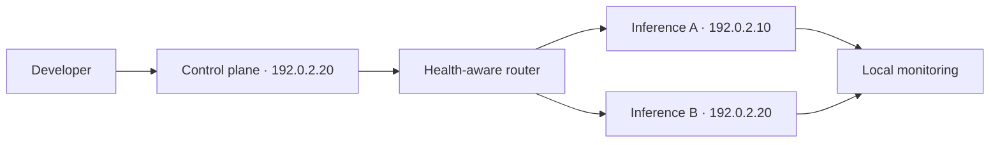

# Agentic AI Workstation Blueprint

> A sanitized, reproducible blueprint for local model serving, agent/RAG workloads, monitoring, routing, and recovery across two fictional nodes.



## Quickstart

```bash
make test
make eval
make validate
docker compose config
make demo
```

## What I built

- Health-aware capacity routing and deterministic failover.
- Recovery traces and no-capacity behavior.
- Minimal Docker Compose, Terraform, and Ansible reference assets.
- Loopback-bound containers and configuration validation.
- Ten operational scenarios across 30 trials.

## What is mocked

The nodes, topology, workloads, domains, and addresses are fictional. Container images are immutable-digest pinned, while Terraform and Ansible remain local validation examples.

## Known limitations

This blueprint does not claim benchmarks from a live cluster. GPU drivers, real remote access, cloud accounts, and production secrets are deliberately excluded.

All addresses use documentation-only ranges and all domains use `example.com`. See [SECURITY.md](SECURITY.md) and [PROVENANCE.md](PROVENANCE.md).
